# NEXUS 360 — Enterprise Decision Intelligence

Plataforma de Business Intelligence em **Power BI Project (PBIP · TMDL + PBIR)** para uma distribuidora nacional B2B fictícia. Os dados são sintéticos e os processos empresariais são realistas.

O projeto foi construído de ponta a ponta:
- engenharia de dados e modelo semântico em estrela;
- 222 medidas DAX validadas contra SQL e Python;
- 11 telas com componentes HTML/SVG e Deneb (Vega-Lite);
- simulador What-if, calendário operacional e arquitetura de assistente de IA com ferramentas tipadas.

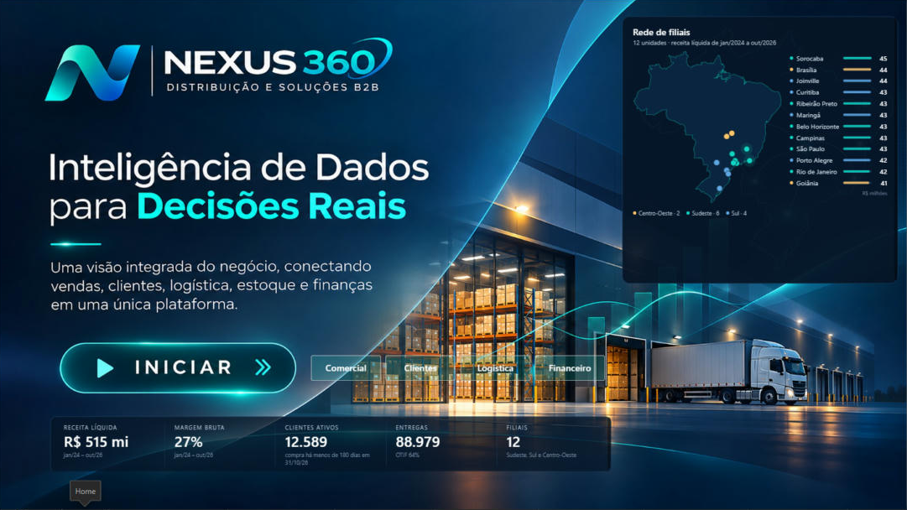

## Telas

| | |
|---|---|
| **01 Executive Command Center** — onde a empresa ganha ou perde resultado | **02 Commercial Intelligence** — quem vende mais, com qual mix e a que custo de desconto |
| 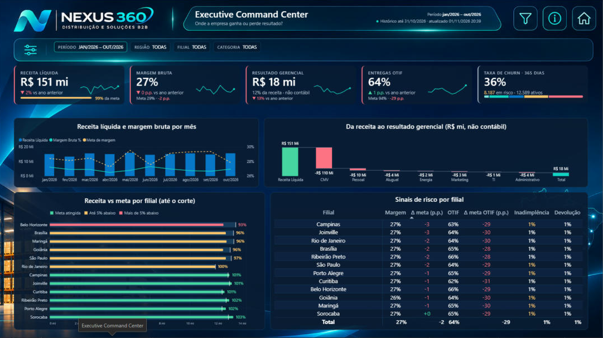 | 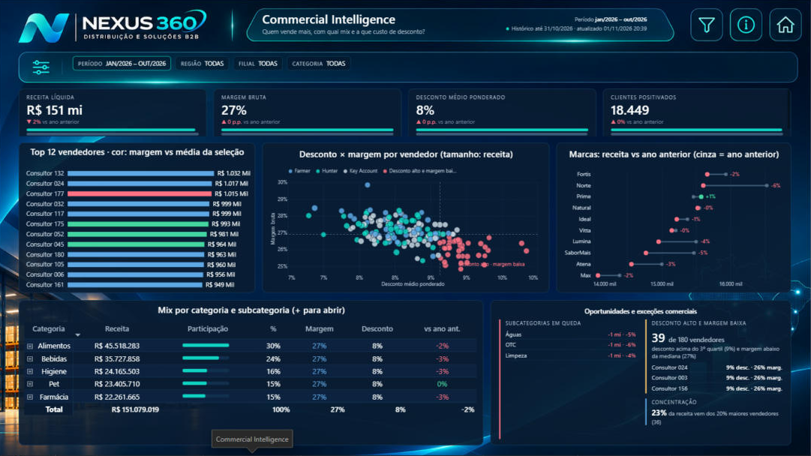 |
| **03 Customer Intelligence** — churn 365 dias, risco, reativação, cohort | **04 Logistics Control Tower** — OTIF, atrasos, transportadoras, frete |
| 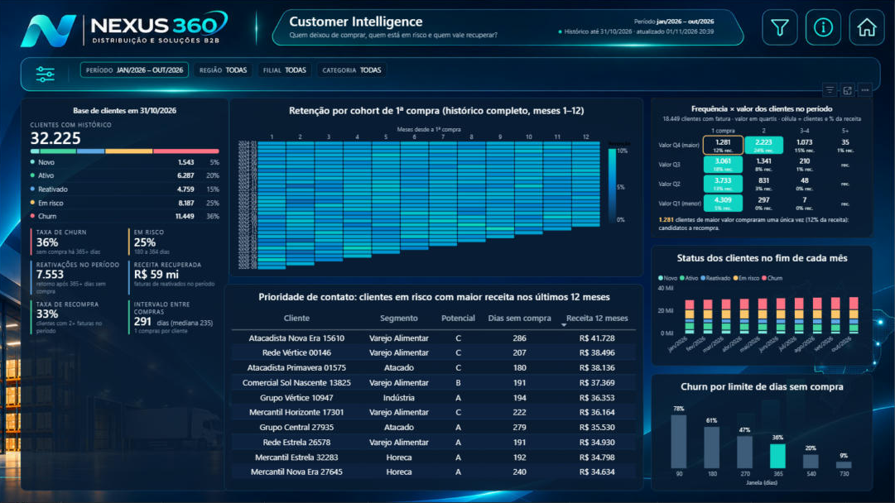 | 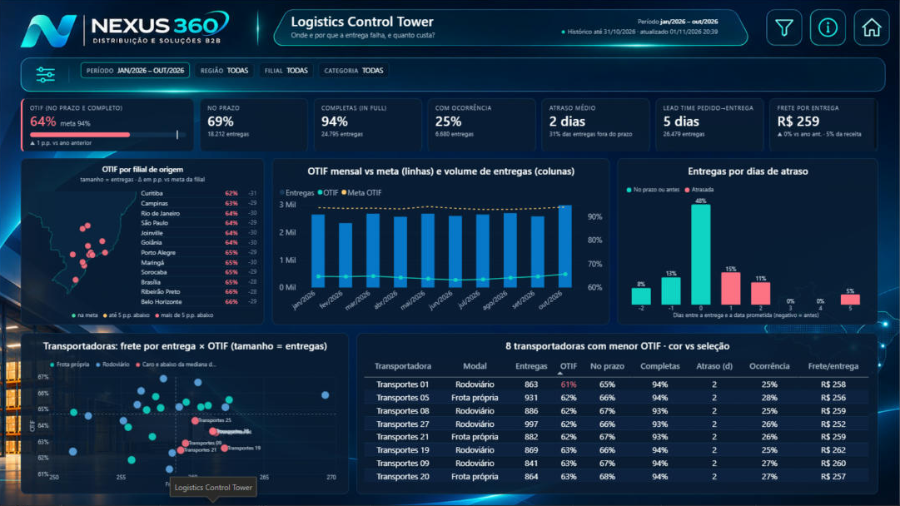 |
| **05 Warehouse Digital Twin (2D)** — posições X×Y×nível do último snapshot WMS | **06 Financial & Profitability** — DRE gerencial, ponte vs ano anterior, caixa, Pareto |
| 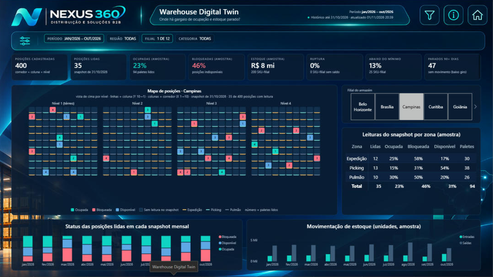 | 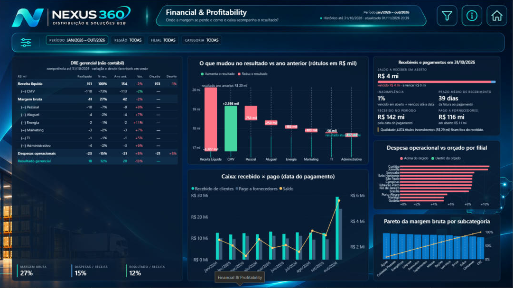 |
| **07 Predictive Intelligence** — projeção sazonal com faixa de 90% e backtest | **08 Decision Simulator** — preço, desconto, volume, custo, frete e despesas |
| 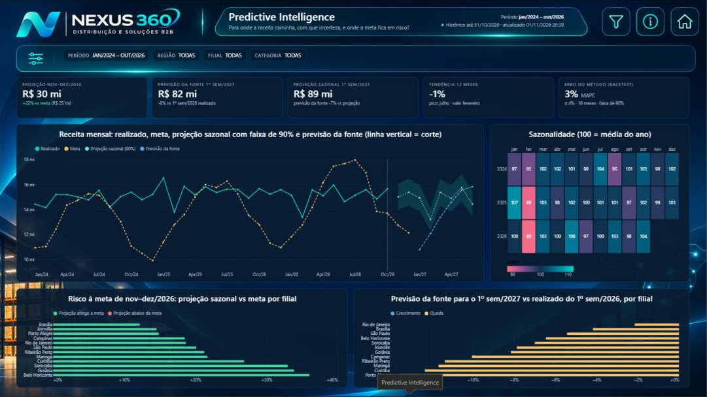 | 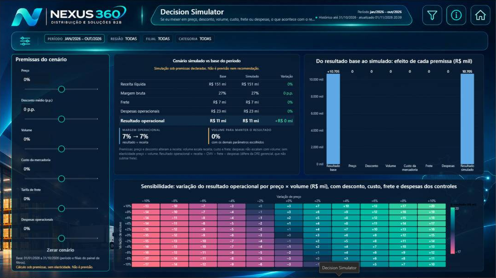 |
| **09 Operations Calendar** — campanhas, visitas e entregas dia a dia | **10 AI Decision Assistant** — ferramentas tipadas e consultas DAX governadas (integração pendente) |
| 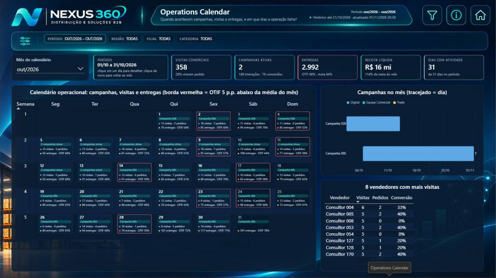 | 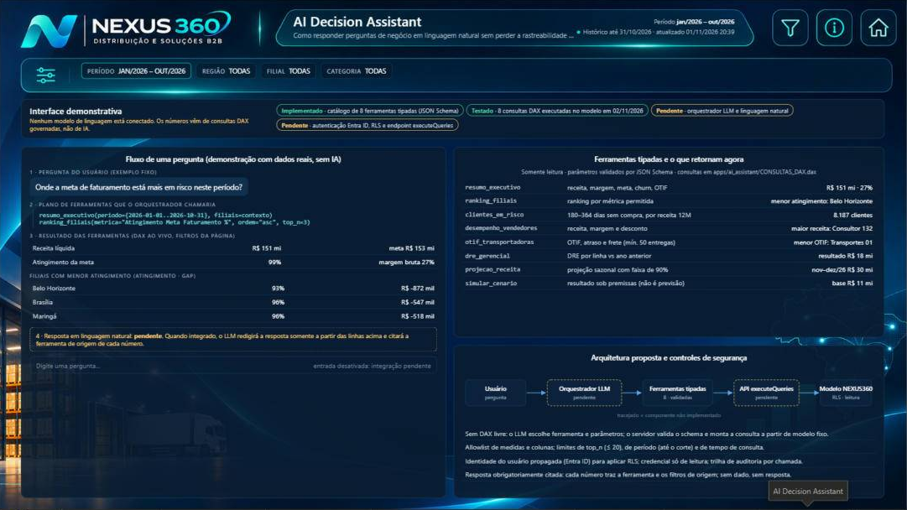 |

## Como abrir
1. Extraia `NEXUS360_CSV_PARTE_01.zip` a `_04.zip` numa pasta. Também é possível usar `RECONSTRUIR_BANCO_WINDOWS.bat`.
2. Abra `pbip/NEXUS360.pbip` no Power BI Desktop (versão de out/2026 ou mais recente; formatos PBIR e TMDL).
3. Em **Transformar dados → Parâmetros**, aponte `pPastaDados` para a pasta dos CSV (terminada em `\`) e atualize.
4. Os visuais de terceiros **HTML Content Secure** e **Deneb** são carregados do AppSource.

## Estrutura
| Pasta | Conteúdo |
|---|---|
| `pbip/` | Projeto Power BI: `NEXUS360.SemanticModel` (TMDL), `NEXUS360.Report` (PBIR) e `_gerador/` (scripts Python que geram páginas, medidas, tema e padrão visual) |
| `documentacao/` | Modelo semântico, dicionário de medidas, relacionamentos, melhorias |
| `documentacao_tecnica/` | Documentos 01–08 (BRD, dicionário de dados, DAX, wireframes, componentes, storytelling, arquitetura, QA) |
| `testes/resultados/` | QA do modelo e de cada página: componentes, medidas, interações, Performance Analyzer, problemas e pendências |
| `testes/screenshots/` | Capturas de validação no Desktop |
| `docs/galeria/` | Capturas das telas usadas neste README |
| `apps/ai_assistant/` | Catálogo de 8 ferramentas (JSON Schema), consultas DAX parametrizadas e especificação de integração |
| `tema/`, `assets/` | Tema Power BI e imagens de fundo |
| `00_*.md` | Inventário, auditoria dos dados, plano e registro de decisões, status |

## Destaques técnicos
- **Modelo:** 45 tabelas e 69 relações, todas unidirecionais (nenhuma bidirecional). Receita no grão de item faturado. As medidas sem grão de produto ficam em branco quando há filtro de produto.
- **Churn:** status exclusivos (Novo, Ativo, Reativado, Em risco 180–364 dias, Churn ≥ 365 dias), com os limites como parâmetros.
- **Projeção:** sazonal × tendência de 12 meses, com faixa de 90% (t de Student) estimada no backtest de 10 meses. O resultado em DAX bate com o Python.
- **Simulador:** parâmetros What-if com ponte de efeitos que fecha no resultado simulado e grade de sensibilidade preço × volume.
- **Padrão visual gerado por código** (`pbip/_gerador/nx_estilo.py`): fontes +20%, tabelas +30%, colunas centralizadas e valores inteiros.
- **Performance:** visuais abaixo de 300 ms no Performance Analyzer, exceto o status mensal da página Customer (1,1 s, pendente de otimização).

## Status
Detalhes em [`00_STATUS_DESENVOLVIMENTO.md`](00_STATUS_DESENVOLVIMENTO.md).

O que ainda não está concluído:
- **Assistente de IA:** a integração com LLM, Entra ID, RLS e `executeQueries` está pendente. A página é uma interface demonstrativa com dados reais, sem IA conectada.
- **Gêmeo digital 3D:** a aplicação complementar em Three.js ainda não foi construída. A versão 2D está funcional no Power BI.

---
Portfólio técnico **Bocardi Data Insight** · dados 100% sintéticos.
